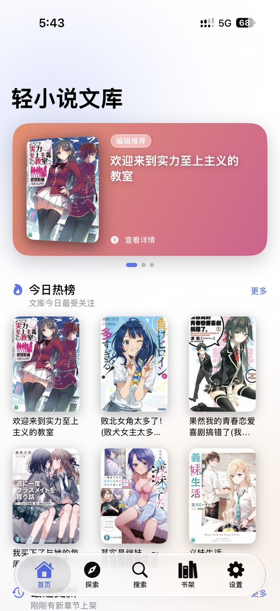
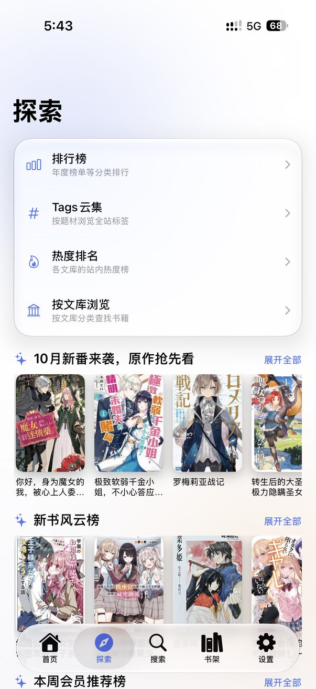
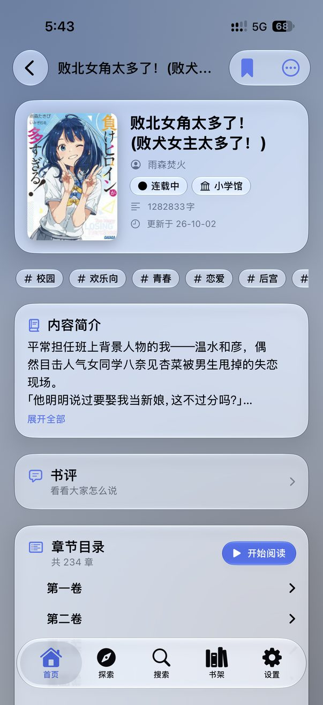
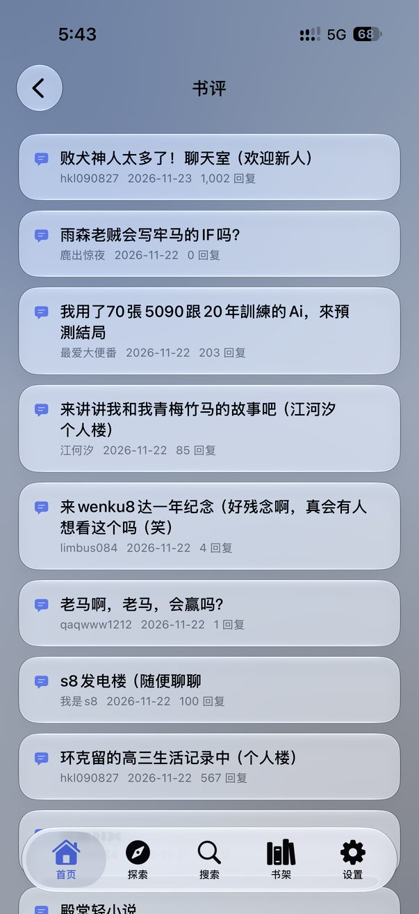
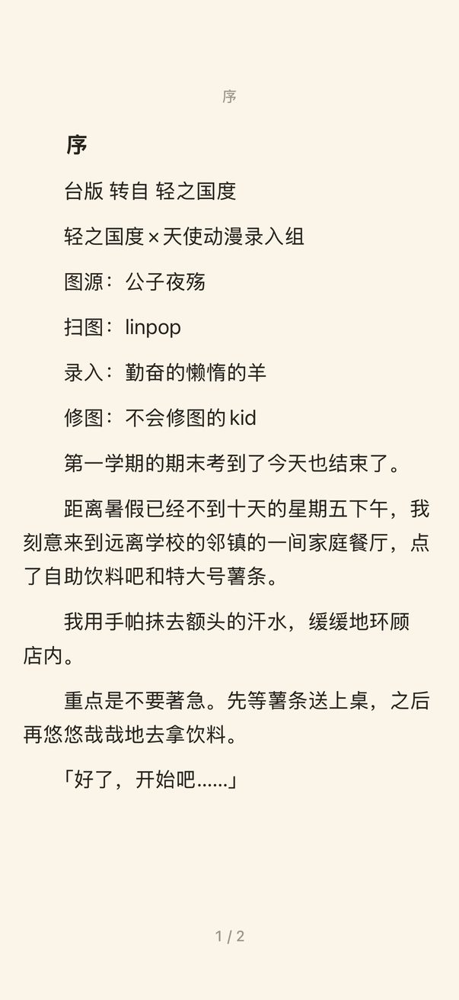

# 轻小说文库 iOS

轻小说文库（wenku8.net）的第三方 iOS 客户端，提供云端书架同步、离线下载与完整的阅读设置。

| 正式版 | 系统要求 | 许可证 |
| --- | --- | --- |
|  |  |  |

[Bangumi]: http://bangumi.tv

轻小说文库 iOS 版用 SwiftUI 编写，界面采用 iOS 26 起的液态玻璃风格，同时兼容 iOS 17 及以上系统，提供尽可能简单且舒适的阅读体验。

> 本项目参考 [MewX/light-novel-library_Wenku8_Android](https://github.com/MewX/light-novel-library_Wenku8_Android) 的功能划分与交互结构，为 iOS 平台独立实现。

[立即下载](#下载)

## 主要功能

### 发现你想读的书

- 首页每日更新：今日热榜、最近更新、新书风云、每周书单
- 探索页整合站点首页的全部推荐板块，可展开查看或跳转到对应榜单
- 12 个排行榜：日、周、月的点击与推荐榜，以及年度、最新入库、字数、热度等分类
- 热度排名：总榜与各文库榜，共 20 个榜单

|  |  |
|:---:|:---:|
| 首页 | 探索 |

### 丰富的检索方式：标签、文库、搜索

> 标签与文库分类由文库站点提供，登录后可用

- Tags 云集：按题材分类浏览全站标签，附站点的标签使用说明
- 按文库浏览：按文库分类查找作品
- 按书名或作者搜索，自动保存搜索历史

### 书籍详情与书评

- 详情页显示作品标签，点击标签可查看同标签的其他作品
- 标签书单支持最近更新、热门、已完结、已动画化四种查看方式
- 书评列表与楼层，支持分页浏览

|  |  |
|:---:|:---:|
| 书籍详情与标签 | 书评 |

### 离线阅读

- 整本书连同插图下载到本机，无网络时正常阅读
- 支持按卷下载，并在中断后继续
- 断网后书架、封面、简介与目录照常显示
- 在设置中查看缓存占用、按书籍清理

### 云同步书架与进度

- 与文库账号的书架双向同步，分组与网站保持一致
- 本地收藏的书籍会在同步时上传，不会只留在设备上
- 每本书的阅读进度独立记录，打开即继续上次位置

### 精心排版的阅读器

- 四种配色：纸白、护眼、夜间、跟随系统
- 字号、行距与首行缩进实时调节，无需退出阅读
- 两种翻页方式：上下滑动与左右翻页
- 章节目录随时跳转，插图支持全屏缩放

|  |
|:---:|
| 阅读器 |

### 精美界面

- 液态玻璃材质，适配浅色、深色与着色模式
- 封面取色：详情页与书评页的背景跟随书籍封面配色
- 原生标签栏与系统返回手势
- 适配 iPad，支持横屏阅读

## 下载

App 未上架 App Store，需自行签名安装。

- 稳定版本：功能稳定

  [下载最新版本](https://github.com/jijijitian/light-novel-library_Wenku8_iOS/releases/latest)

**设备要求**：iOS 17.0 或更新版本。

### 安装

任选一种方式签名安装：

- **Xcode**：克隆仓库后执行 `bash tools/bootstrap-xcodeproj.sh device`，用 Xcode 打开工程即可
- **AltStore / SideStore / Sideloadly**：导入 release 中的 `.ipa`，使用自己的 Apple ID 重签
- **企业证书或自签工具**：按惯用方式签名

首次安装后需在 **设置 → 通用 → VPN 与设备管理** 中信任开发者证书。免费证书有效期为 7 天，到期后重新签名即可。

## 技术总览

- SwiftUI 架构，适配 iOS 17 至 iOS 26；
- 核心解析与网络层独立为 `Wenku8Core` 模块；
- 网页解析不依赖第三方 HTML 库，GBK 解码自带码表；
- 封面与元数据落盘缓存，冷启动直接出内容。

## FAQ

### 为什么部分页面需要登录？

文库对未登录访客只开放部分内容：排行榜、标签页、站点首页的推荐板块都需要登录后才会显示。登录一次即可长期使用。

### 为什么个别书籍无法打开？

少数书籍在文库网页端本身就不可读，App 会在失败时给出明确提示，不会静默留白。

### 账号密码会被保存吗？

不会。密码仅在登录时提交给文库，App 不存储密码，登录状态保存在系统 Cookie 中，退出登录时清除。

### 资源来源是什么？

全部小说内容均来自轻小说文库公开网页。本 App 不存储、不转售任何作品内容，版权归原作者与出版机构所有。

### 是否使用了 MewX/light-novel-library_Wenku8_Android 的中转 API 服务？

没有。本 App 直接读取轻小说文库网页版，不经过任何第三方中转服务器。

部分受限书籍的插图章节在网页端已无法访问，App 会向一个自建服务查询这些插图的位置；
该服务只返回图片地址，图片本身仍从文库使用的图床加载，不涉及任何小说正文。

### 站点打不开怎么办？

在 **设置 → 数据来源** 中可以在 `wenku8.net`、`wenku8.cc`、`wenku8.com` 三个域名之间切换。三处指向同一个站点，账号与书架不受影响。

### 支持哪些系统？

iOS 17.0 及以上。液态玻璃效果需要 iOS 26 或更新版本，旧系统会自动使用半透明材质。

## 反馈

使用中遇到问题或有功能建议，欢迎在 [Issues](https://github.com/jijijitian/light-novel-library_Wenku8_iOS/issues) 中提出。

## 致谢

- [MewX/light-novel-library_Wenku8_Android](https://github.com/MewX/light-novel-library_Wenku8_Android)：功能与交互参考
- [celia-sh/Novella](https://github.com/celia-sh/Novella)：封面取色与书籍详情页的配色方案参考
- [Aidoku](https://github.com/Aidoku/Aidoku)：应用图标设计参考

## 许可

本项目基于 [GPL-2.0](https://github.com/jijijitian/light-novel-library_Wenku8_iOS/blob/master/LICENSE) 协议开源，与原始 Android 项目一致。
